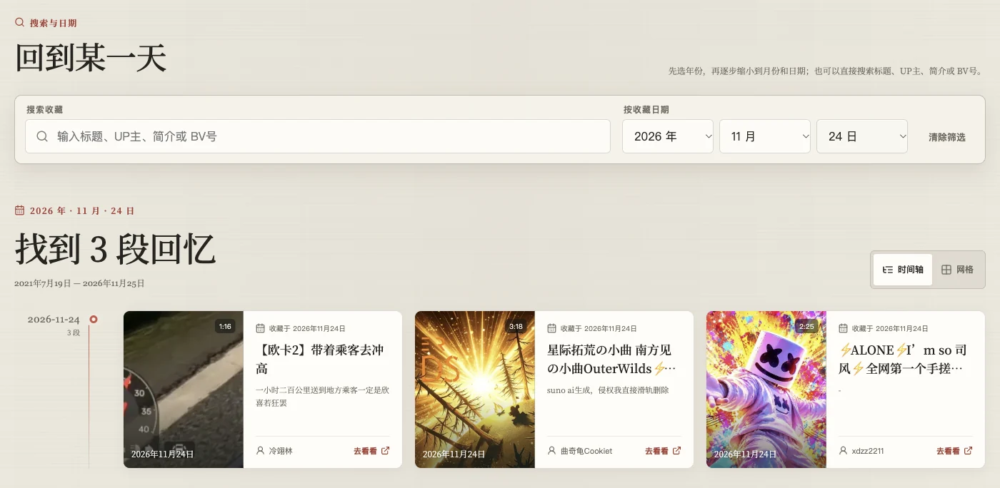
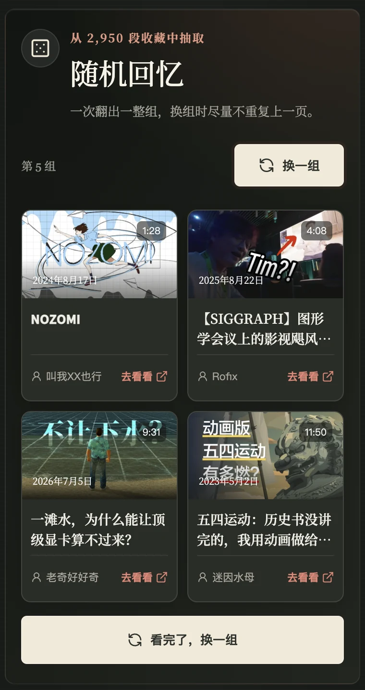

[简体中文](README.md) | **English**

# Shiguang · Bilibili Favorites Time Machine

Turn your Bilibili favorites into a timeline. Go back to the day you saved a video, or shuffle through a few old favorites.

**[Open Shiguang](https://drivinggodj.github.io/shiguang-memory/)** · [User guide](docs/GUIDE.en.md)

## Return to the day you saved it

Pick a year, month, and day to see what you saved. Search by title, creator, description, or BV ID when you remember a detail. Follow the timeline by date or switch to the grid to scan the covers.

<picture>
  <source media="(prefers-color-scheme: dark)" srcset="docs/images/shiguang-desktop-dark.webp">
  
</picture>

## Rediscover old favorites

<table>
  <tr>
    <td width="37%" align="center" valign="middle">
      
       
      Mobile · Dark mode
    </td>
    <td width="63%" valign="middle">
      
<strong>Random Memories</strong> picks four videos at a time. Shuffle to see another set. New cards fade in, with support for the system's reduced-motion setting.

      
<strong>On This Day</strong> groups favorites saved on the same date in past years. Previously synced records can remain available after a video is removed.

      
<strong>Two columns on phones</strong> put the creator and watch link on one line. Titles and reading text use Source Han Serif styling, and light or dark appearance follows your system.

    </td>
  </tr>
</table>

## Start revisiting

1. Open the site, enter a Bilibili UID or profile URL, and choose a public favorites folder. You can also paste a folder link.
2. Wait for the first sync. The index is saved in your current browser so you can pick up where you left off.
3. On phones, add Shiguang to your home screen for quick access.

Shiguang reads public favorites folders only. No Bilibili login is required.

## Explore further

| Topic | Documentation |
| --- | --- |
| Import, sync, home-screen installation and date limitations | [User guide](docs/GUIDE.en.md) |
| Local data, request statistics and usage limits | [Data and usage details](docs/GUIDE.en.md#usage) |
| Self-hosting, development and maintenance | [Maintenance (Chinese)](MEMORY_WEB.md) |
| Feedback | [Issues](https://github.com/DrivingGodJ/shiguang-memory/issues) |

The Bilibili favorites API integration draws on [BiliShelf](https://github.com/TLRKFXE/BiliShelf)'s open-source implementation and preserves the original copyright notice. [MIT License](LICENSE) · [Third-party notices](THIRD_PARTY_NOTICES.md)
