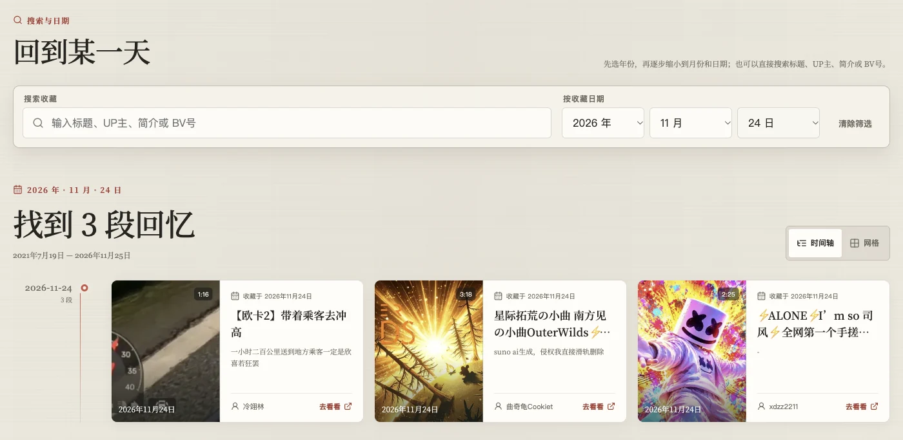
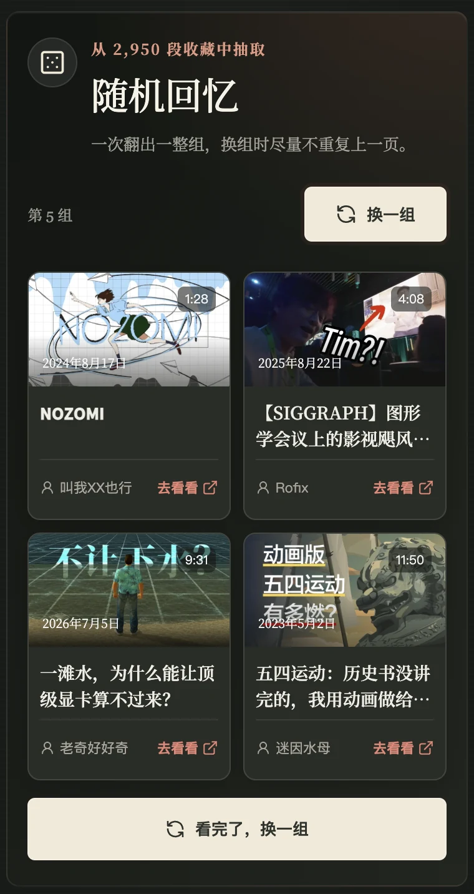

**简体中文** | [English](README.en.md)

# 拾光 · B站收藏时光机

把 B 站收藏夹变成一条可以按日期回看的时间线，找回某一天存下的视频，也可以随手翻出一组旧收藏。

**[打开拾光](https://drivinggodj.github.io/shiguang-memory/)** · [使用指南](docs/GUIDE.zh-CN.md)

## 回到收藏它的那一天

选年份、月份和日期，看看那天收了什么。记得一小段标题、UP 主、简介或 BV 号时，可以直接搜索。用时间轴顺着日期翻找，也可以切到网格快速扫过封面。

<picture>
  <source media="(prefers-color-scheme: dark)" srcset="docs/images/shiguang-desktop-dark.webp">
  
</picture>

## 随手翻翻旧收藏

<table>
  <tr>
    <td width="37%" align="center" valign="middle">
      
       
      手机端 · 深色模式
    </td>
    <td width="63%" valign="middle">
      
<strong>随机回忆</strong> 每次抽出 4 条视频，点「换一组」继续翻。新卡片轻轻淡入，动效跟随系统的「减少动态效果」设置。

      
<strong>那年今日</strong> 把往年同一天的收藏按年份展开。曾同步的记录在视频失效后仍可保留。

      
<strong>手机双列</strong> 每行两条，UP 主和「去看看」排在同一行。标题和正文采用思源宋体风格，界面随系统切换明暗。

    </td>
  </tr>
</table>

## 开始回看

1. 打开网页，输入 B 站 UID 或空间链接，选一个公开收藏夹。也可以直接粘贴收藏夹链接。
2. 等待首次同步。收藏索引保存在当前浏览器，下次打开可以接着看。
3. 手机上可以把拾光添加到主屏幕，方便随时打开。

无需登录 B 站。拾光只读公开收藏夹。

## 进一步了解

| 想了解什么 | 去哪里看 |
| --- | --- |
| 导入、同步、主屏幕安装与日期限制 | [使用指南](docs/GUIDE.zh-CN.md) |
| 本地数据、请求统计和使用限制 | [数据与使用说明](docs/GUIDE.zh-CN.md#使用说明) |
| 自托管、开发与维护 | [维护文档](MEMORY_WEB.md) |
| 问题反馈 | [Issues](https://github.com/DrivingGodJ/shiguang-memory/issues) |

B 站收藏接口适配参考了 [BiliShelf](https://github.com/TLRKFXE/BiliShelf) 的开源实现，保留原作者版权。[MIT License](LICENSE) · [第三方声明](THIRD_PARTY_NOTICES.md)
